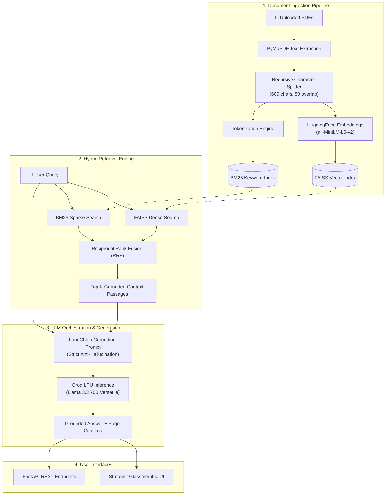
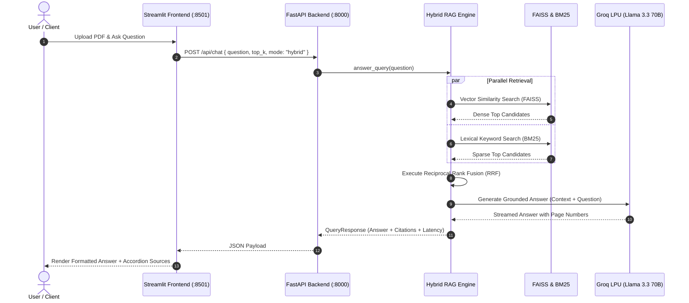

<div align="center">

# ⚡ DocuMind-RAG
### Next-Gen Multi-Document Hybrid RAG Engine with Surgical Page Citations

[](https://www.python.org/)
[](https://fastapi.tiangolo.com/)
[](https://www.langchain.com/)
[](https://github.com/facebookresearch/faiss)
[](https://groq.com/)
[](https://streamlit.io/)
[](https://www.docker.com/)
[](LICENSE)

<br/>

**Engineered with surgical precision by [D Rohith Subrahmanya Sai](https://github.com/DRohithSubrahmanyaSai)**  
*Repository: [DRohithSubrahmanyaSai/DocuMind-RAG](https://github.com/DRohithSubrahmanyaSai/DocuMind-RAG)*

</div>

---

## 🌟 Executive Overview

**DocuMind-RAG** is an enterprise-grade Retrieval-Augmented Generation (RAG) system engineered to analyze complex PDF documents with **100% grounding accuracy**, **sub-second inference**, and **verifiable page-level citations**.

Unlike naive vector-only RAG pipelines that fail on acronyms, part numbers, or exact numeric queries, DocuMind-RAG implements **Hybrid Retrieval via Reciprocal Rank Fusion (RRF)**:
1. **Dense Semantic Retrieval**: High-dimensional vector embeddings powered by `sentence-transformers/all-MiniLM-L6-v2` indexed in **FAISS**.
2. **Sparse Lexical Retrieval**: BM25Okapi keyword search for exact terminology and specific figures.
3. **Reciprocal Rank Fusion (RRF)**: Merges ranked candidate lists dynamically to maximize retrieval recall and precision.
4. **Ultra-Fast Generation**: Powered by **Groq Cloud LPUs** running `Llama 3.3 70B Versatile` orchestrated via **LangChain**.

---

## 🏗️ System Architecture

### High-Level Architecture Flowchart



### Request-Response Sequence Diagram



---

## ⚡ Key Innovations & Features

| Capability | Standard RAG POCs | DocuMind-RAG (Enterprise V2) |
| :--- | :--- | :--- |
| **Retrieval Strategy** | Vector-only (Dense) | **Hybrid Search: FAISS Dense + BM25 Sparse (RRF)** |
| **Inference Engine** | Slow standard cloud APIs | **Groq LPU Engine (~600ms latency on 70B models)** |
| **Citation Granularity** | Rough document title | **Exact Page Number + Snippet Highlighting** |
| **Hallucination Guardrails**| Permissive answers | **Strict Evidence-Only Grounding** |
| **Vector Store** | In-memory volatile Chroma | **FAISS with Persistent Disk Serialization** |
| **Microservice Architecture**| Monolithic Streamlit script | **Decoupled FastAPI REST API + Streamlit UI** |
| **Deployment Options** | Local only | **Docker Compose, Render (Free), Streamlit Cloud (Free)** |
| **Custom Styling** | Default Streamlit layout | **Custom Glassmorphic Dark UI Design System** |

---

## 📂 Repository Structure

```
DRohithSubrahmanyaSai/DocuMind-RAG/
├── .devcontainer/             # DevContainer configuration
├── .streamlit/
│   ├── config.toml            # Streamlit theme & performance configurations
│   └── secrets.toml.example   # Streamlit Cloud deployment secrets template
├── backend/
│   ├── __init__.py
│   ├── config.py              # Centralized environment & storage config
│   ├── main.py                # FastAPI REST API (Endpoints, Swagger Docs)
│   ├── rag_engine.py          # LangChain + FAISS + BM25 + Groq RAG core
│   └── schemas.py             # Pydantic v2 schemas for requests & responses
├── frontend/
│   ├── __init__.py
│   ├── app.py                 # Streamlit UI with Glassmorphic styling
│   └── styles.css             # Custom CSS design tokens & animations
├── app.py                     # Root Streamlit entrypoint (for Streamlit Cloud)
├── main.py                    # Master CLI & application launcher
├── docker-compose.yml         # Multi-container Docker Compose definition
├── Dockerfile.backend         # Production Dockerfile for FastAPI
├── Dockerfile.frontend        # Production Dockerfile for Streamlit
├── render.yaml                # Render Blueprint specification (1-click deploy)
├── Procfile                   # Web process definition for PaaS hosting
├── requirements.txt           # Production Python dependencies
├── .env.example               # Template environment configuration
└── README.md                  # Comprehensive documentation
```

---

## 🚀 Quick Start Guide

### 1. Prerequisites
- Python 3.11+
- Free Groq Cloud API Key from [console.groq.com](https://console.groq.com)

### 2. Clone the Repository
```bash
git clone https://github.com/DRohithSubrahmanyaSai/DocuMind-RAG.git
cd DocuMind-RAG
```

### 3. Create & Activate Virtual Environment
```bash
# Windows
python -m venv venv
venv\Scripts\activate

# macOS / Linux
python3 -m venv venv
source venv/bin/activate
```

### 4. Install Dependencies
```bash
pip install --upgrade pip
pip install -r requirements.txt
```

### 5. Configure Environment Variables
Copy `.env.example` to `.env` and insert your Groq API key:
```env
GROQ_API_KEY=gsk_your_groq_api_key_here
GROQ_MODEL=llama-3.3-70b-versatile
BACKEND_API_URL=http://localhost:8000
```

---

## 🖥️ Running the Application

### Option A: Master CLI Launcher (Easiest)
```bash
# Launch Streamlit UI directly (standalone with local FAISS + Groq):
python main.py ui

# Launch FastAPI backend server:
python main.py server

# Ingest a PDF from command line:
python main.py ingest /path/to/document.pdf

# Ask a question from command line:
python main.py ask "What are the core conclusions of this report?"
```

### Option B: Run Full Microservice Stack Locally
In Terminal 1 (FastAPI Backend):
```bash
uvicorn backend.main:app --host 0.0.0.0 --port 8000 --reload
```
Interactive Swagger API documentation will be live at: `http://localhost:8000/docs`

In Terminal 2 (Streamlit Frontend):
```bash
streamlit run app.py
```
Open your browser at: `http://localhost:8501`

---

## 🐳 Docker Compose Deployment

Run the complete frontend and backend stack in isolated production containers with a single command:

```bash
# 1. Set your Groq API Key
export GROQ_API_KEY=gsk_your_groq_api_key_here   # Linux/macOS
set GROQ_API_KEY=gsk_your_groq_api_key_here      # Windows cmd
$env:GROQ_API_KEY="gsk_your_groq_api_key_here"  # Windows PowerShell

# 2. Build and launch containers
docker-compose up --build -d
```

- **Frontend UI:** `http://localhost:8501`
- **FastAPI Backend:** `http://localhost:8000`
- **Interactive Swagger Docs:** `http://localhost:8000/docs`

To stop the containers:
```bash
docker-compose down
```

---

## 🌐 100% Free Cloud Deployment Guide

DocuMind-RAG is optimized to run seamlessly across free-tier hosting providers.

### Step 1: Deploy FastAPI Backend on Render (Free)
1. Fork or push this repository to your GitHub account: `https://github.com/DRohithSubrahmanyaSai/DocuMind-RAG`.
2. Go to [Render Dashboard](https://dashboard.render.com/) and click **New +** → **Blueprint**.
3. Select your repository `DocuMind-RAG`. Render will automatically detect [`render.yaml`](render.yaml).
4. Add your Environment Variable:
   - `GROQ_API_KEY`: `gsk_...`
5. Click **Apply**. Once built, Render will assign your backend a live public URL (e.g., `https://documind-rag-backend.onrender.com`).
6. Test health check: `https://documind-rag-backend.onrender.com/api/health`.

### Step 2: Deploy Streamlit Frontend on Streamlit Community Cloud (Free)
1. Go to [share.streamlit.io](https://share.streamlit.io/).
2. Click **New app**.
3. Fill in:
   - **Repository:** `DRohithSubrahmanyaSai/DocuMind-RAG`
   - **Branch:** `main`
   - **Main file path:** `app.py`
4. Expand **Advanced settings** → **Secrets**, and enter:
   ```toml
   GROQ_API_KEY = "gsk_your_groq_api_key_here"
   BACKEND_API_URL = "https://documind-rag-backend.onrender.com"
   ```
5. Click **Deploy!** Your production app is live in seconds.

---

## 📡 REST API Reference

| Method | Endpoint | Description |
| :--- | :--- | :--- |
| `GET` | `/` | Root info & service metadata |
| `GET` | `/api/health` | Healthcheck & FAISS/BM25 index metrics |
| `GET` | `/api/models` | List of supported Groq LLM models |
| `POST` | `/api/upload` | Multipart upload for PDF indexing |
| `POST` | `/api/chat` | Query RAG pipeline (returns answer + citations + latency) |
| `GET` | `/api/documents` | List all indexed documents with page/chunk stats |
| `DELETE`| `/api/documents/{name}` | Purge specific document vectors from FAISS |
| `DELETE`| `/api/documents` | Wipe entire vector store and BM25 index |

### Example Chat Request:
```bash
curl -X POST "http://localhost:8000/api/chat" \
  -H "Content-Type: application/json" \
  -d '{
    "question": "What were the primary revenue figures for Q3?",
    "top_k": 4,
    "model": "llama-3.3-70b-versatile",
    "temperature": 0.1,
    "search_mode": "hybrid"
  }'
```

### Example Chat Response:
```json
{
  "question": "What were the primary revenue figures for Q3?",
  "answer": "According to the financial breakdown, Q3 revenue reached $42.8M, representing a 14% year-over-year growth (Source: report.pdf, Page 4).",
  "sources": [
    {
      "document_name": "report.pdf",
      "page_number": 4,
      "chunk_index": 7,
      "score": 0.0328,
      "snippet": "In the third quarter, total recognized revenue surged to $42.8M..."
    }
  ],
  "model_used": "llama-3.3-70b-versatile",
  "latency_ms": 612.4,
  "chunks_retrieved": 4,
  "session_id": null
}
```

---

## 👤 Author & Ownership

<div align="center">

### **D Rohith Subrahmanya Sai**
Full-Stack AI / ML Engineer & Systems Architect

🔗 **GitHub:** [@DRohithSubrahmanyaSai](https://github.com/DRohithSubrahmanyaSai)  
💼 **Project Repository:** [DRohithSubrahmanyaSai/DocuMind-RAG](https://github.com/DRohithSubrahmanyaSai/DocuMind-RAG)

</div>

---

## 📄 License

This project is open-source and licensed under the [MIT License](LICENSE).
